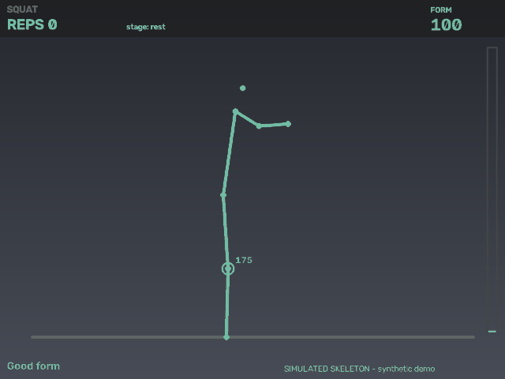
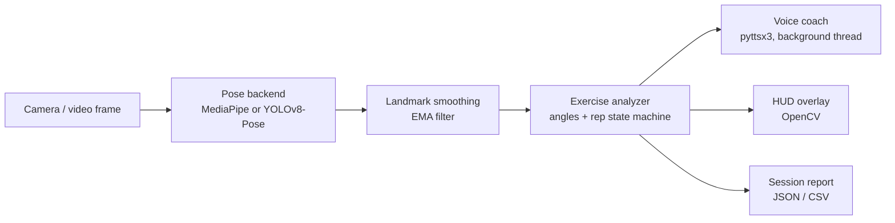

<div align="center">

# 🏋️ FormFit AI

**Real-time AI gym trainer & posture corrector.**
Tracks your joint angles with MediaPipe or YOLOv8-Pose, counts reps, scores your form and *talks you through* every set.

[](https://github.com/MHanzala74/FormFit-AI/actions/workflows/ci.yml)




<sub>Simulated skeleton from <code>examples/synthetic_demo.py</code> running through the real analysis pipeline - no camera needed.</sub>

</div>

---

## ✨ Features

- **Two pose backends, one interface** - MediaPipe Pose (fast on CPU) or YOLOv8-Pose (robust with multiple people), switchable with `--backend`.
- **5 exercises** - squat, push-up, lunge, bicep curl and plank (timed holds). Adding a new one takes ~30 lines.
- **Joint-angle analysis** - knee, elbow, torso lean, body line and arm drift computed from keypoints every frame.
- **Rep counting with quality gates** - a rep only counts if you reach the target depth; shallow reps get *"Go lower"*.
- **Per-rep form score (0-100)** - posture issues and rushed tempo ("Slow down") lower the score.
- **Real-time voice coaching** - offline text-to-speech (`pyttsx3`) in a background thread, with a cooldown so it never nags.
- **Smooth, stable tracking** - exponential-moving-average landmark smoothing to cut keypoint jitter.
- **Live HUD** - skeleton, angle labels, rep counter, depth progress bar and warnings, drawn onto the video.
- **Session reports** - JSON + CSV export with per-rep timing, peak angle, score and most common mistakes.
- **Analyze recorded videos** - `formfit analyze clip.mp4 -o annotated.mp4` for offline processing.
- **Streamlit web app** - upload a clip, get charts and downloadable reports in the browser.
- **Tested & CI'd** - synthetic-pose unit tests and an end-to-end pipeline test on GitHub Actions (Python 3.10-3.12).

## 🚀 Quick start

```bash
git clone https://github.com/MHanzala74/FormFit-AI.git
cd FormFit-AI
python -m venv venv && source venv/bin/activate     # Windows: venv\Scripts\activate
pip install -e .                                    # core: OpenCV, MediaPipe, pyttsx3
# optional extras
pip install -e ".[yolo]"                            # YOLOv8-Pose backend
pip install -e ".[web]"                             # Streamlit app
```

### Live coaching from your webcam

```bash
formfit run --exercise squat
formfit run -e pushup --backend yolo --report session.json
formfit run -e plank --no-voice --record workout.mp4
```

Film yourself from the **side** with your whole body in frame. Press `q` or `Esc` to finish and see your session summary.

### Analyze a recorded video

```bash
formfit analyze workout.mp4 -e lunge -o annotated.mp4 --report report.json --csv reps.csv
```

### Web app

```bash
make web        # or: streamlit run src/formfit/app/streamlit_app.py
```

### Try it without a camera

```bash
python examples/synthetic_demo.py --gif demo.gif
```

> `python main.py run -e squat` also works straight from a checkout without installing.

## 🧍 Supported exercises

| Exercise | Primary angle (depth) | Form checks | Feedback examples |
|---|---|---|---|
| `squat` | Knee (hip-knee-ankle) | Torso lean from vertical | "Go lower", "Keep your chest up" |
| `pushup` | Elbow (shoulder-elbow-wrist) | Shoulder-hip-ankle body line | "Don't let your hips sag", "Lower your hips" |
| `lunge` | Working knee | Torso lean | "Lunge deeper", "Keep your torso upright" |
| `curl` | Elbow | Upper-arm drift, torso sway | "Curl all the way up", "Keep your elbow by your side" |
| `plank` | Body line (timed hold) | Hip sag / pike, body tilt | "Don't let your hips sag", "10 seconds" |

Thresholds and the maths behind each rule are documented in [`docs/exercises.md`](docs/exercises.md).

## 🧠 How it works



1. The backend returns 13 normalised landmarks (nose, shoulders, elbows, wrists, hips, knees, ankles) with visibility scores.
2. The analyzer picks the better-visible body side and computes joint angles, e.g. the knee angle at vertex *B* of hip-*B*-ankle: `θ = arccos((BA · BC) / (|BA||BC|))`.
3. A small state machine (`rest → active → rest`) counts a rep when the primary angle drops past the target and returns to rest, and scores it from posture issues and tempo.
4. Feedback is spoken, drawn, and stored for the report. See [`docs/architecture.md`](docs/architecture.md).

## 🗂️ Project structure

```
FormFit-AI/
├── src/formfit/
│   ├── cli.py                 # `formfit run | analyze | list`
│   ├── pipeline.py            # frames -> pose -> smoothing -> analysis -> overlay/voice
│   ├── config.py              # Settings dataclass
│   ├── core/                  # angles, smoothing, shared types (pure Python)
│   ├── pose/                  # MediaPipe + YOLOv8-Pose backends behind one interface
│   ├── exercises/             # base state machine + squat, pushup, lunge, curl, plank
│   ├── feedback/              # non-blocking voice coach
│   ├── session/               # session summary + JSON/CSV export
│   ├── ui/                    # OpenCV skeleton/HUD drawing
│   └── app/streamlit_app.py   # web UI
├── tests/                     # synthetic-pose unit tests + end-to-end pipeline tests
├── examples/synthetic_demo.py # camera-free demo
├── docs/                      # architecture + exercise definitions
├── assets/                    # demo GIF, sample report
└── .github/                   # CI workflow, issue/PR templates
```

## 🧪 Development

```bash
pip install -e ".[dev,web]"
make test      # pytest
make lint      # ruff
make demo      # regenerate assets/demo.gif
```

Because exercises are driven by landmark dictionaries, the whole analysis stack is tested with **synthetic poses** - no camera, GPU or model download required.

## ⚠️ Limitations

- Angles are measured in 2D image space, so results are most reliable from a **true side view** with the full body visible and good lighting.
- Thresholds are sensible defaults, not medical or coaching advice; tune them in the exercise classes for your body and camera setup.
- The demo GIF is a simulated skeleton. Real-world accuracy depends on the pose backend and filming conditions.

## 🛣️ Roadmap

- [x] MediaPipe + YOLOv8-Pose backends
- [x] Squat, push-up, lunge, bicep curl, plank
- [x] Rep counting, form score, tempo check
- [x] Voice feedback, HUD, session reports
- [x] Streamlit video-analysis app
- [ ] Front-view checks (knee valgus, shoulder symmetry)
- [ ] Deadlift, shoulder press, jumping jacks
- [ ] 3D angles from MediaPipe world landmarks
- [ ] Workout history dashboard across sessions
- [ ] Real-footage demo clips

## 🤝 Contributing

Contributions are welcome - see [CONTRIBUTING.md](CONTRIBUTING.md). Adding an exercise is the easiest first PR.

## 📄 License

[MIT](LICENSE) © MHanzala74
